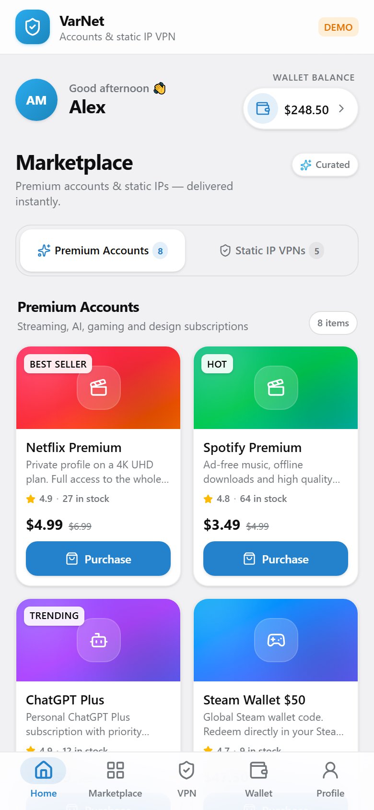
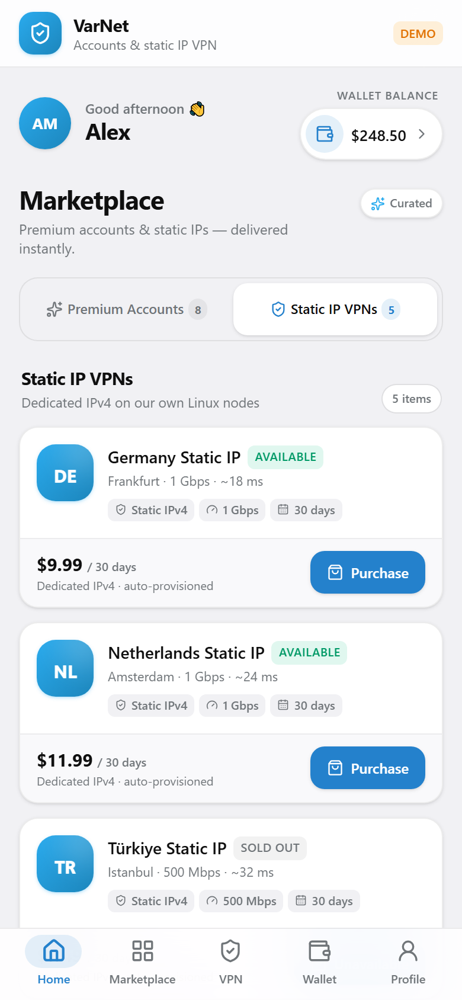
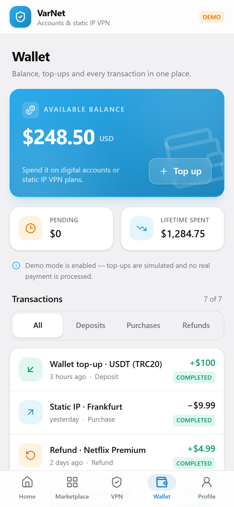
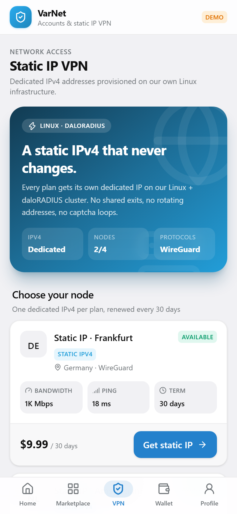
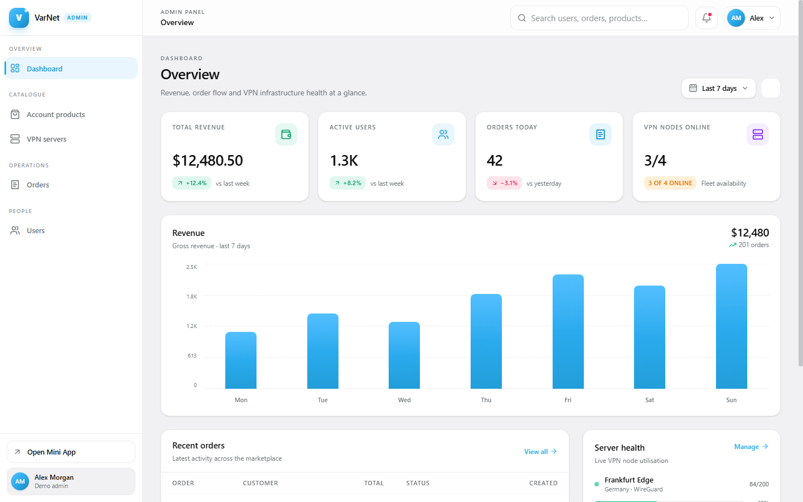

# VarNet Frontend

Telegram Mini App marketplace for **digital accounts** and **Static IP VPNs**, plus a desktop-first **web admin panel** — a clean, scalable frontend skeleton built with Vite, React, TypeScript and Tailwind CSS.

Digital accounts and the wallet are served from local fixtures for now. The **VPN backend** is live: the Linux RADIUS server at `https://api-var.popserver.shop` (`/v1/*`). Digital accounts will move to a third-party provider behind a Cloudflare proxy that keeps the API key server-side.

---

## Tech stack

| Layer | Choice |
| --- | --- |
| Build tool | Vite 8 (`@vitejs/plugin-react`) |
| UI | React 19 + TypeScript 7 (strict) |
| Styling | Tailwind CSS v4 (CSS-first `@theme`, no `tailwind.config.js`) |
| Locale | Persian **fa-IR**, full RTL, Vazirmatn typeface |
| Routing | `react-router-dom` 7 (`/app/*` Mini App, `/admin/*` admin) |
| State | Zustand 5 (`useAuthStore`, `useWalletStore`) |
| HTTP | axios with interceptors (`src/services/apiClient.ts`) |
| Telegram | `@twa-dev/sdk` 8 + official `telegram-web-app.js` |
| Icons | `lucide-react` |
| Lint | oxlint (`npm run lint`) |

---

## Quick start

```bash
# 1. install dependencies (already scaffolded in this repo)
npm install

# 2. configure environment
cp .env.example .env        # PowerShell: Copy-Item .env.example .env

# 3. run the dev server
npm run dev                 # http://localhost:5173
```

The app opens with a demo Telegram session, so no Telegram client and no backend are required to browse the skeleton:

- Mini App: `http://localhost:5173/app`
- Marketplace: `http://localhost:5173/app/marketplace`
- Static IP VPNs: `http://localhost:5173/app/vpn`
- Wallet: `http://localhost:5173/app/wallet`
- Orders: `http://localhost:5173/app/orders`
- Profile: `http://localhost:5173/app/profile`
- Admin panel: `http://localhost:5173/admin`

Other scripts:

```bash
npm run build      # tsc -b && vite build  -> dist/
npm run preview    # serve the production build on :4173
npm run typecheck  # tsc -b
npm run lint       # oxlint
```

### From scratch (reference)

```bash
npm create vite@latest . -- --template react-ts
npm install react-router-dom zustand axios @twa-dev/sdk lucide-react clsx tailwind-merge
npm install -D tailwindcss @tailwindcss/vite
```

---

## Preview

| Marketplace · Premium Accounts | Marketplace · Static IP VPNs | Wallet |
| --- | --- | --- |
|  |  |  |

| VPN catalogue (`/app/vpn`) | Admin dashboard |
| --- | --- |
|  |  |

Captured from the production build in mock/demo mode.

---

## Project structure

```text
.
├── index.html                  # Telegram SDK script + offline fallback shim
├── vite.config.ts              # React + Tailwind plugins, "@" alias
├── tsconfig.app.json           # strict TS, "@/*" path mapping
├── .env / .env.example         # VITE_API_BASE_URL, VITE_DEMO_MODE
└── src/
    ├── main.tsx                # Telegram bootstrap + session hydration + mount
    ├── App.tsx                 # router: /app/* Mini App, /admin/* admin, 404
    ├── index.css               # design tokens, Telegram theme bridge, utilities
    ├── config/
    │   └── env.ts              # typed access to import.meta.env
    ├── types/
    │   └── index.ts            # domain model = API contract
    ├── lib/
    │   ├── utils.ts            # cn(), sleep, initials, clamp
    │   ├── i18n.ts             # shared Persian (fa-IR) domain labels
    │   └── format.ts           # Persian digits, Jalali dates, relative time
    ├── services/
    │   ├── apiClient.ts        # axios instance, interceptors, ApiError
    │   ├── endpoints.ts        # every backend route in one place
    │   ├── telegram.ts         # @twa-dev/sdk wrapper (safe outside Telegram)
    │   ├── accounts.service.ts # marketplace products (local fixtures)
    │   ├── vpn.service.ts      # live /v1 plans, provisioning, usage, RADIUS
    │   ├── wallet.service.ts   # balance, transactions (local fixtures)
    │   ├── orders.service.ts   # order history (local fixtures)
    │   ├── admin.service.ts    # stats, users, servers, admin orders (fixtures)
    │   └── mocks.ts            # demo data for accounts, wallet and admin
    ├── store/
    │   ├── authStore.ts        # session (Telegram user/token/role)
    │   └── walletStore.ts      # balance + transaction feed
    ├── hooks/
    │   └── useTelegram.ts      # isTelegram, user, haptic, openLink
    ├── routes/
    │   └── AdminGuard.tsx      # protects /admin/* (demo mode bypass)
    ├── components/
    │   ├── ui/                 # Button, Card, Badge, Input, Sheet, Skeleton, …
    │   ├── shared/             # AppErrorBoundary, ScrollToTop
    │   ├── miniapp/            # Mini App product/VPN cards, nav, sections
    │   ├── wallet/             # transaction rows, top-up sheet, order cards
    │   └── admin/              # stat cards, tables, charts, sidebar widgets
    ├── layouts/
    │   ├── MiniAppLayout.tsx   # mobile shell + bottom tab bar + <Outlet/>
    │   └── AdminLayout.tsx     # sidebar + top bar + <Outlet/>
    └── pages/
        ├── NotFoundPage.tsx
        ├── miniapp/            # Home, Marketplace, VPN, Wallet, Orders, Profile
        └── admin/              # Dashboard, Users, Products, VpnServers, Orders
```

---

## Environment variables

Only variables prefixed with `VITE_` reach the browser bundle — never put secrets in them.

| Variable | Default | Purpose |
| --- | --- | --- |
| `VITE_API_BASE_URL` | `https://api-var.popserver.shop` | Root of the Linux RADIUS backend (no trailing slash, no `/api`). |
| `VITE_DEMO_MODE` | `true` | Seeds a demo session outside Telegram and lets `/admin` be explored. **Turn off in production.** |

> `.env` is git-ignored; commit changes to `.env.example` instead.

---

## Routing

| Route | Surface | Screen |
| --- | --- | --- |
| `/` | — | Redirects to `/app` |
| `/app` | Mini App | Marketplace: **Premium Accounts** + **Static IP VPNs** tabs, wallet balance header |
| `/app/marketplace` | Mini App | Account products with search + category filters |
| `/app/vpn` | Mini App | Static IP VPN plans + node status |
| `/app/wallet` | Mini App | Balance, top-up sheet, transaction history |
| `/app/orders` | Mini App | Order history |
| `/app/profile` | Mini App | Telegram profile + menu |
| `/admin` | Admin | KPIs, revenue chart, recent orders, server health |
| `/admin/users` | Admin | User management |
| `/admin/products` | Admin | Account product management |
| `/admin/vpn-servers` | Admin | VPN node inventory |
| `/admin/orders` | Admin | Order management |
| `*` | — | 404 page |

Routes are declared in a single table in [`src/App.tsx`](src/App.tsx). Mini App screens are imported eagerly (instant first paint inside the Telegram WebView); the admin panel is code-split with `React.lazy`, so Mini App users never download admin tables, charts or icons.

---

## Localization (فارسی / RTL)

The whole product is Persian-first (`fa-IR`) and right-to-left.

- **Direction** — `<html lang="fa" dir="rtl">` in `index.html`; `body` inherits it and `src/index.css` re-asserts `direction: rtl` as a safety net.
- **Font** — [Vazirmatn](https://fonts.google.com/specimen/Vazirmatn) is loaded from Google Fonts in `index.html`. Tailwind v4 has **no `tailwind.config.js`**: the typeface and design tokens are configured with `@theme` in `src/index.css` (`--font-sans: "Vazirmatn", …`), which exposes `font-sans`, `text-tg-text`, `bg-tg-bg`, etc.
- **Copy** — shared domain labels (navigation, statuses, categories, common actions) live in `src/lib/i18n.ts` (`fa`); page-specific Persian copy lives inline in each component/page.
- **Formatting** — always use `src/lib/format.ts`: `formatCurrency`/`formatNumber` render Persian digits, `formatDate`/`formatDateTime` render Jalali dates, `formatRelativeTime` renders Persian relative time. Never call `toLocaleString('en-US')`.
- **RTL utilities** — use logical properties: `ms-*`/`me-*`, `ps-*`/`pe-*`, `start-*`/`end-*`, `text-start`/`text-end`, `border-s`/`border-e`; prefer `gap-*` over `space-x-*`. Forward/navigation icons point **left** in RTL.
- **Bidi safety** — Latin-only values inside Persian text (IPs, hostnames, order IDs, `@usernames`) use the `bidi-ltr` utility or `<bdi dir="ltr">`.
- **Typography** — never letter-space Persian script (`tracking-*`); `src/index.css` neutralizes letter-spacing on text elements as a guard.
- **Adding another language** — move inline copy into per-locale modules, expose `dir`/`lang` per locale, and pick the locale at bootstrap.

---

## Telegram Mini App integration

1. **SDK script** — the official `telegram-web-app.js` is loaded in `index.html` before the bundle because `@twa-dev/sdk` binds to `window.Telegram.WebApp` on import. A tiny fallback shim keeps `npm run dev` working in a normal browser or offline.
2. **Boot** — `src/main.tsx` calls `initTelegram()` (`ready`, `expand`, theming) and `useAuthStore.hydrateSession()`.
3. **Theme** — `src/index.css` maps the injected `--tg-theme-*` variables to Tailwind tokens. Pages use `bg-tg-bg`, `text-tg-text`, `bg-tg-button`, `text-tg-hint`, `border-tg-separator`, … so light/dark themes adapt with zero JS. Fallback palettes follow the OS colour scheme outside Telegram.
4. **Auth** — `initData` is attached to every request by the axios interceptor (`X-Telegram-Init-Data`). Backend flow to implement: validate it, create/lookup the user, return a JWT; store it via `useAuthStore.setSession()`.
5. **Haptics** — `useTelegram().haptic()` / `notify()` are safe no-ops in the browser.
6. **Registration** — set the bot's menu button / Mini App URL to the deployed `/app` route (HTTPS required).

---

## API layer

There are two data sources by design:

| Domain | Source | Status |
| --- | --- | --- |
| Static IP VPN — plans, provisioning, usage, RADIUS lifecycle | Linux RADIUS server at `https://api-var.popserver.shop/v1` | **Live** |
| Digital accounts, wallet, orders, admin | `src/services/mocks.ts` | Local fixtures until the provider proxy exists |

`src/services/apiClient.ts` is the single axios instance for the live VPN backend:

```ts
import { apiGet, apiPost } from '@/services/apiClient'
import { endpoints } from '@/services/endpoints'

const plans = await apiGet<VpnPlanRecord[]>(endpoints.vpn.plans)
await apiPost(endpoints.vpn.provision, { external_ref, plan_code, order_id })
// baseURL = VITE_API_BASE_URL (defaults to https://api-var.popserver.shop)
```

- **Auth header** — the request interceptor adds `Authorization: Bearer <token>` from the token set via `setApiAuthToken()` (mirrored in `localStorage` under `varnet.auth.token`). The Telegram `initData` is sent as `X-Telegram-Init-Data`.
- **401 handling** — a rejected authenticated request clears the stored token, emits to `onUnauthorized()` subscribers (the auth store drops the session), and still rejects with `ApiError`.
- **Errors** — helpers (`apiGet`, `apiGetData`, `apiPost`, `apiPostData`, `apiPatchData`, `apiDelete`) normalise every failure into `ApiError` (status, code, Persian message — FastAPI `detail` strings/validation arrays supported). Envelope-aware variants also unwrap `{ success, data }`.

Every route lives in `src/services/endpoints.ts` under `endpoints.vpn`:

| Function | Route |
| --- | --- |
| `listVpnPlans()` | `GET /v1/plans` |
| `fetchVpnCustomer(externalRef)` | `GET /v1/customers/{external_ref}` |
| `provisionVpn({ externalRef, planCode, orderId })` | `POST /v1/provision` |
| `fetchVpnUsage(username)` | `GET /v1/usage?username=…` |
| `suspendVpnUser` / `resumeVpnUser` / `deleteVpnUser` | `POST /v1/radius/{suspend,resume,delete}` |
| `deleteVpnCustomer(externalRef)` | `POST /v1/customer/delete` |
| `syncVpnPlan(...)` | `POST /v1/sync_plan` |
| `fetchVpnStatus()` / `fetchVpnDbHealth()` | `GET /v1/status`, `GET /v1/db-health` |

`listVpnPlans()` maps the RADIUS rows (`plan_code`, `quota_bytes`, `duration_seconds`, …) onto the UI's `VpnPlan` model; `VpnPlan.id` is the `plan_code` so it can be passed straight to `provisionVpn()`. The API exposes no node geography or inventory, so plans render with a generic location and are treated as in stock while `plan_status === 'ACTIVE'`. Node inventory stays on the local fixtures.

---

## State management

- `useAuthStore` — `user`, `token`, `status`, `isAdmin`, `hydrateSession()`, `setSession()`, `clearSession()`.
- `useWalletStore` — `balance`, `currency`, `transactions`, `topUp(amount)`, `loadWallet()`, `loadTransactions()`.

Both are plain Zustand stores; add `persist()` middleware for `localStorage` caching when needed.

---

## Development conventions

- `@/` always maps to `src/` — no long relative paths.
- `import type` for type-only imports (`verbatimModuleSyntax` is on).
- Theme via tokens only: **do not** use `dark:` variants or hardcoded colours (Telegram controls light/dark through CSS variables).
- Prefer shared primitives from `src/components/ui` over ad-hoc markup.
- Keep pages thin: data fetching in services, derivations in stores/lib, presentation in components.

---

## Before production

- [ ] Wire `provisionVpn()` into the confirmation sheet for VPN purchases (currently logs the id).
- [ ] Stand up the Cloudflare proxy for digital accounts + wallet and replace `src/services/mocks.ts`.
- [ ] Decide how the RADIUS `Authorization` credential is issued — `/v1/status`, `/v1/provision` and the RADIUS mutations reject unauthenticated calls.
- [ ] Set `VITE_DEMO_MODE=false` so `/admin` requires the `admin` role.
- [ ] Allow the deployed frontend origin in the RADIUS server's CORS list (only `https://web.telegram.org` is allowed today; `localhost` is not).
- [ ] Replace placeholder product artwork (gradient + emoji) with `imageUrl` from the provider.
- [ ] Merge the two `TransactionRow` components (`components/miniapp` preview vs `components/wallet` full row) once a shared query cache lands.
- [ ] Add a real top-up/payment flow (Telegram Stars / crypto / card gateway) and order creation.
- [ ] Add tests (Vitest + Testing Library) and CI (typecheck + lint + build).

